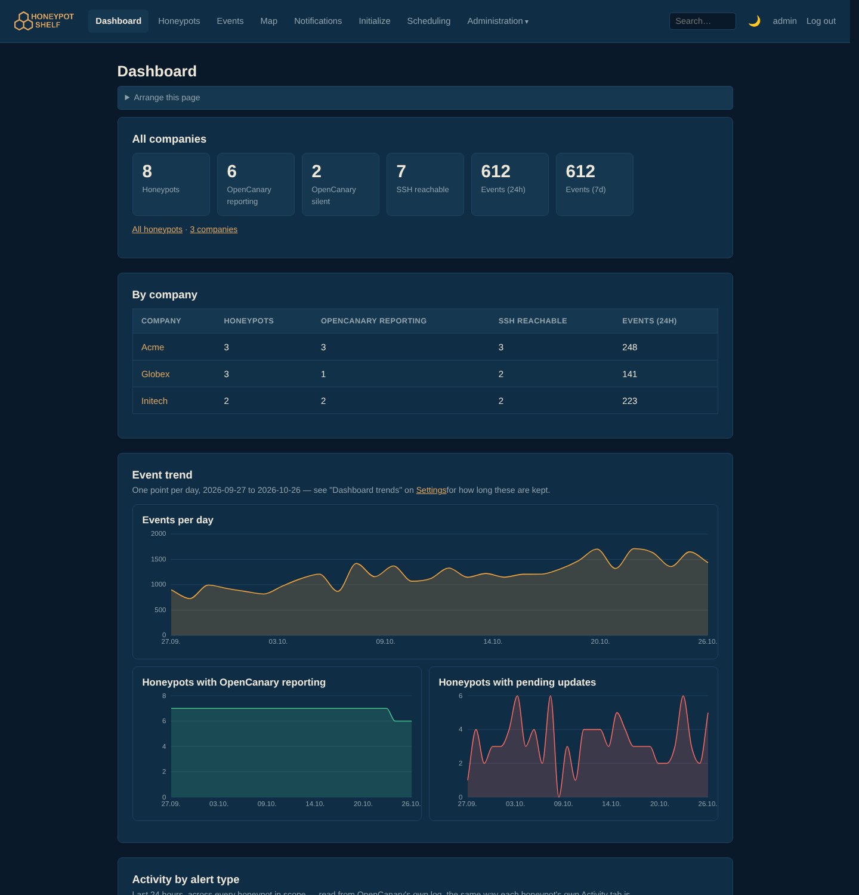
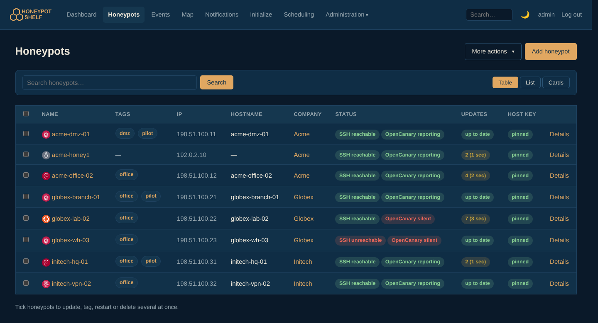
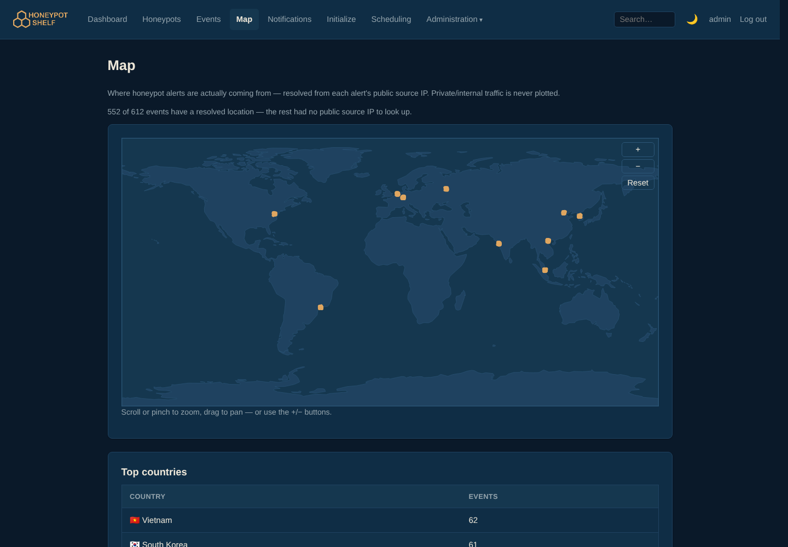
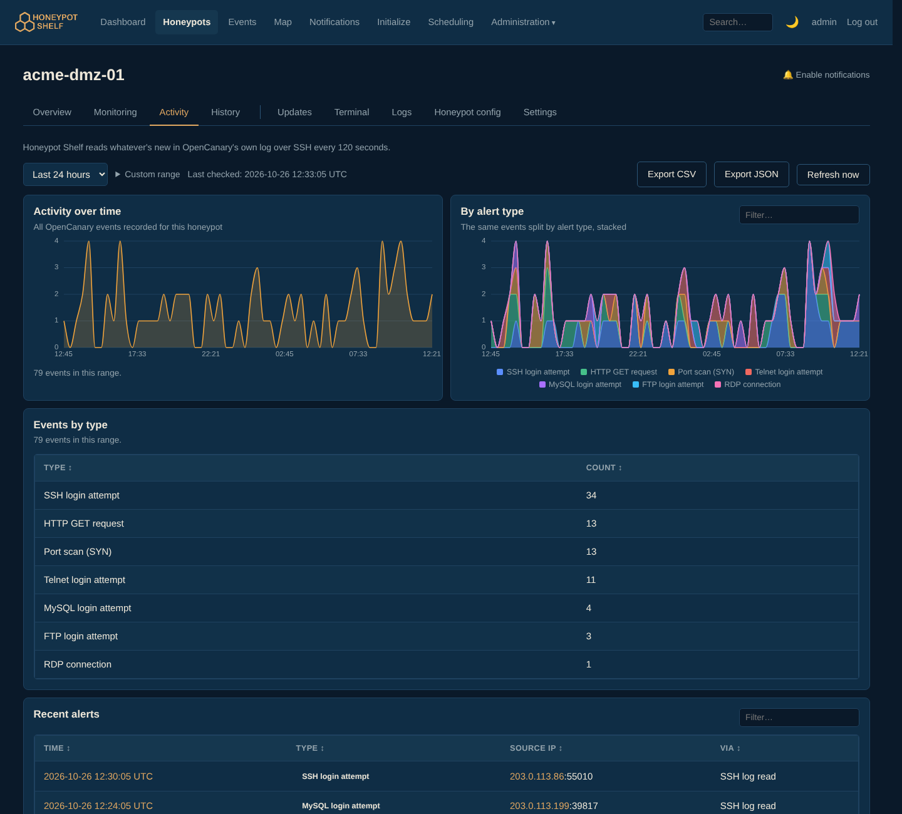
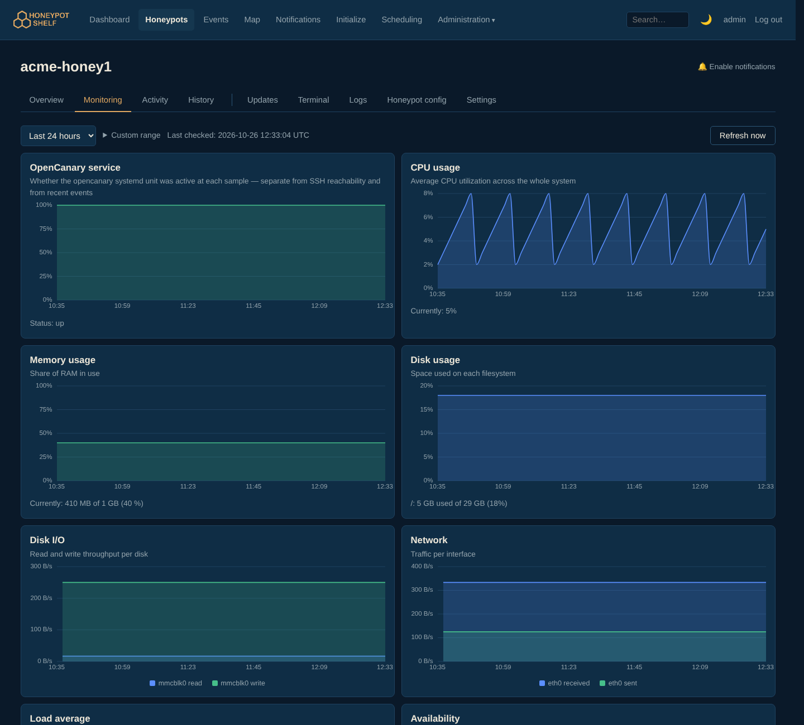

<p align="center">
  
</p>

<h3 align="center">Run a fleet of OpenCanary honeypots from one browser tab.</h3>

<p align="center">
  Deploy decoys at every site, see every intrusion attempt the moment it happens,<br>
  and keep the honeypots themselves patched, monitored and healthy — for many companies at once.
</p>

<p align="center">
  <a href="https://github.com/sparkycz1/honeypot-shelf/actions/workflows/ci.yml"></a>
  <a href="https://github.com/sparkycz1/honeypot-shelf/actions/workflows/codeql.yml"></a>
  <a href="https://github.com/sparkycz1/honeypot-shelf/actions/workflows/fuzz.yml"></a>
  <a href="https://scorecard.dev/viewer/?uri=github.com/sparkycz1/honeypot-shelf"></a>
  <a href="https://github.com/sparkycz1/honeypot-shelf/releases/latest"></a>
  <a href="LICENSE"></a>
</p>

<p align="center">
  
  
  
  
  
  
  
</p>

<p align="center">
  <a href="#-quick-start"><b>Quick start</b></a> ·
  <a href="https://github.com/sparkycz1/honeypot-shelf/wiki"><b>Documentation</b></a> ·
  <a href="https://github.com/sparkycz1/honeypot-shelf/wiki/REST-API"><b>REST API</b></a> ·
  <a href="https://github.com/sparkycz1/honeypot-shelf/releases"><b>Releases</b></a>
</p>



## 🐝 What it is

A honeypot is a fake server nobody should ever touch — so any connection
to it is an intruder, a compromised machine or a misconfigured scanner.
[OpenCanary](https://github.com/thinkst/opencanary) makes a cheap
Raspberry Pi into a convincing one. **Honeypot Shelf** is what you need
once you have more than a couple of them: one place to set them up, watch
what they catch, and keep them running.

- **Built for many customers.** Each honeypot belongs to one or more
  companies; each user gets read or read + write access per company. A
  managed-security provider can run every customer's decoys from one
  instance, and each customer only ever sees their own.
- **Nothing to install on the honeypot.** Honeypot Shelf reads
  OpenCanary's own log over SSH — no agent, no forwarder, no inbound port
  on your side.
- **From a fresh OS install to a working honeypot in one form.** *Initialize*
  provisions a fresh Raspberry Pi OS, Debian or Ubuntu device over SSH,
  with live progress.

## ✨ Highlights

| | |
|---|---|
| 📊 **Dashboard and map** | Attacks per day, per company and per alert type, honeypots reporting or silent, and a world map of where the attempts come from (GeoIP). Each account arranges its own Dashboard. |
| 📋 **Events** | Every OpenCanary alert across the fleet, filterable by source, type, country and time, exportable to CSV and JSON. Expected visitors (your own scanner) can be ignored without losing the data. |
| 🔔 **Notifications** | Each user builds their own rules: email, webhook, ntfy, Gotify, Telegram, Discord, Pushover, Slack, Mattermost or Teams. Throttling, maintenance windows and acknowledgements keep the noise down. |
| 🍯 **Honeypot management** | Browser SSH terminal, logs, live monitoring charts, an editor for every OpenCanary module, a MAC address that makes the Pi look like a printer, watched files, hardware and warranty records. |
| ⬆️ **Updates that don't bite** | Security-only, safe or full upgrades, one honeypot at a time if you like, reboot only when needed, and a one-click rollback. |
| ⏱️ **Scheduling** | Cron jobs for updates, reboots and commands, each in its own time zone, plus a calendar and maintenance windows. |
| 🔐 **Serious about security** | Local, LDAP or OIDC sign-in with TOTP and passkeys, a hash-chained audit log, pinned SSH host keys, strict CSP, AES-256-GCM secrets at rest, syslog/Wazuh forwarding. |
| 🌐 **REST API** | Token-authenticated, company-scoped, with live Swagger docs at `/api`. |

<table>
  <tr>
    <td width="50%"><br><sub><b>Honeypots</b> — reachability, OpenCanary status and pending updates at a glance</sub></td>
    <td width="50%"><br><sub><b>Map</b> — where the attempts come from</sub></td>
  </tr>
  <tr>
    <td width="50%"><br><sub><b>Activity</b> — what one honeypot caught, by alert type</sub></td>
    <td width="50%"><br><sub><b>Monitoring</b> — the Pi's own health over time</sub></td>
  </tr>
</table>

## 🚀 Quick start

You need a Linux host with Docker and Docker Compose. One interactive
script does the rest:

```bash
git clone https://github.com/sparkycz1/honeypot-shelf.git
cd honeypot-shelf
python3 scripts/setup.py
```

It generates every secret, asks a few questions (time zone, the bundled
Caddy reverse proxy or your own, the superadmin password, the port),
starts the stack and creates the first superadmin account. Then add a
honeypot, or turn a fresh Raspberry Pi into one with **Initialize**.

> [!WARNING]
> The app itself speaks **plain HTTP only**. Always put TLS in front of it
> (the bundled Caddy does this for you), and don't expose its port
> directly — set `APP_BIND_ADDRESS=127.0.0.1` in `.env` if the proxy runs
> on the same host.

Prefer doing it by hand, or updating an existing install? See
[Installation](https://github.com/sparkycz1/honeypot-shelf/wiki/Installation).
Every setting is listed on
[Configuration](https://github.com/sparkycz1/honeypot-shelf/wiki/Configuration).

## 📚 Documentation

The [wiki](https://github.com/sparkycz1/honeypot-shelf/wiki) has the full
picture:

| | |
|---|---|
| 🚀 [Installation](https://github.com/sparkycz1/honeypot-shelf/wiki/Installation) · [Configuration](https://github.com/sparkycz1/honeypot-shelf/wiki/Configuration) | Install, update, back up, reverse proxies, every setting |
| 🍯 [Honeypot Management](https://github.com/sparkycz1/honeypot-shelf/wiki/Honeypot-Management) · [Initialize](https://github.com/sparkycz1/honeypot-shelf/wiki/Honeypot-Initialize) | Adding and provisioning honeypots, VPN, updates, events |
| 🔔 [Notifications](https://github.com/sparkycz1/honeypot-shelf/wiki/Notifications) · [Scheduling](https://github.com/sparkycz1/honeypot-shelf/wiki/Scheduling) | Alert rules and channels, scheduled tasks, maintenance windows |
| 🔐 [Authentication & RBAC](https://github.com/sparkycz1/honeypot-shelf/wiki/Authentication-RBAC) · [Audit Log](https://github.com/sparkycz1/honeypot-shelf/wiki/Audit-Log) | Sign-in, companies and access levels, the tamper-evident log |
| 🌐 [REST API](https://github.com/sparkycz1/honeypot-shelf/wiki/REST-API) | Tokens, every endpoint, examples |
| 🛠️ [Architecture](https://github.com/sparkycz1/honeypot-shelf/wiki/Architecture) · [Development](https://github.com/sparkycz1/honeypot-shelf/wiki/Development) | How it is built and how to contribute |

## 🧬 Family

Honeypot Shelf shares its stack, look and much of its code with
[debcontrol](https://github.com/sparkycz1/debcontrol), a sister project for
managing Debian fleets: a honeypot here is managed the way a machine is
there. It was originally built for [Faster CZ](https://www.faster.cz/),
and most of it is vibecoded.

## 🔒 Security

Found a vulnerability? Please follow [SECURITY.md](.github/SECURITY.md)
instead of opening a public issue.

## 🤝 Contributing

Issues and pull requests are welcome — see [CONTRIBUTING.md](CONTRIBUTING.md)
and the [Code of Conduct](CODE_OF_CONDUCT.md).

## 📄 License

[PolyForm Noncommercial 1.0.0](LICENSE): free for any noncommercial use
(personal, research, education, nonprofits, public bodies). Commercial use
needs a separate agreement — open an issue or get in touch.
